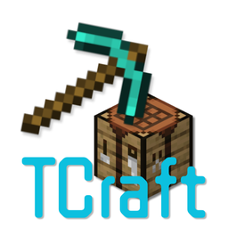
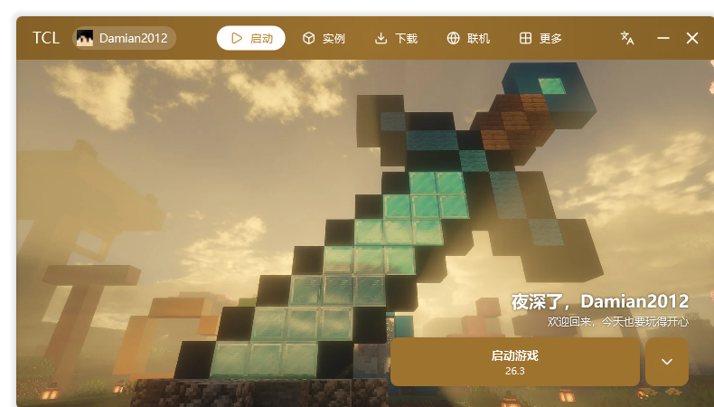

<div align="center">



# TCraft Launcher

**Lighter. Faster.**

A single-file Minecraft launcher: ~3.6 MB, ~2 s cold start. Open source, free, no ads.

[](https://github.com/Damianjiang/TCraft-Launcher/releases)
[](https://github.com/Damianjiang/TCraft-Launcher/releases)
[](LICENSE)
[](https://github.com/Damianjiang/TCraft-Launcher/releases)

[Download](https://github.com/Damianjiang/TCraft-Launcher/releases) · [Website](https://damianjiang.github.io/TCraft-Launcher/en/) · [Changelog](CHANGELOG.md) · [中文文档](README.md) · [Issues](https://github.com/Damianjiang/TCraft-Launcher/issues)



</div>

---

## What is this

TCraft Launcher (short **TCL**) is a Minecraft launcher written in VB.NET / WPF.
There is no installer, no bundle, and no telemetry: the whole program is one
3.6 MB exe. Copy it anywhere and run; delete it to uninstall.

- **Single file**: the launch core and third-party libraries are embedded as compressed snapshots — no runtime dependencies.
- **Fast**: lazy initialization, multi-core JIT profiles and on-demand UI resources give a ~2 s cold start.
- **Fast downloads too**: HTTP/2 multiplexing (Win10 1607+), up to 64 concurrent threads, adjustable speed cap and resumable downloads.
- **Good looking**: Win11-style translucent glass UI with wallpaper color extraction, background video, music and 21 theme colors.
- **Multilingual**: Simplified Chinese / English / Traditional Chinese / auto-detect; every string is editable via `TCL\i18n.json`.
- **Windows 7 supported**: SP1 and above (falls back to a compatibility network stack on old systems).

## Features

| Module | What you get |
| --- | --- |
| Launch | Multi-folder multi-instance, favorites / color tags / collections, list & grid views |
| Accounts | Microsoft device-code login / offline / external Authlib servers (LittleSkin etc.), account cards with import & export |
| Instances | Per-version settings, mod / saves / datapacks / screenshots / servers management, modpack export, Jar-in-Jar embedded dependency viewer & export |
| Modpacks | Parses CurseForge, Modrinth, MCBBS, MultiMC and HMCL formats; shows name, icon, game version and loader before installing |
| Downloads | Vanilla + Forge / NeoForge / Fabric / OptiFine / LiteLoader one-click install; CurseForge & Modrinth search; automatic missing-dependency completion for mods |
| Multiplayer | Virtual LAN sessions powered by EasyTier — create / join rooms, custom relay nodes, auto-join a server after launch |
| Skins | 2D front view + real WPF 3D model preview (classic / slim auto-detected), offline skin upload |
| Extras | Human-readable Chinese crash analysis, categorized cache cleaner, settings import/export (.tcl), global search, full logs |

## Page by page

### Launch

- **Versions**: multi-folder scan, favorites pinned on top, color tags and collection filters; press F11 to reveal hidden versions.
- **Memory**: auto / manual / per-instance; optional locked initial heap (-Xms = -Xmx) for lower latency spikes (great with ZGC).
- **Java**: auto-select by version range (e.g. `[21.0, 25)`), sortable priority list, manual path, bundled-Java detection, auto-download when nothing fits.
- **Arguments & commands**: JVM args, game args and pre-launch commands support Minecraft version JSON markers and TCL replacement tags (`{verpath}`, `{java}`, ...).
- **Advanced fixes**: mesa-loader custom renderer injection, LWJGL Unsafe Agent, Java Launch Wrapper (CJK path fix), automatic high-performance GPU preference.
- **Extras**: process priority, window title & size customization, launch-script export, auto-hide / auto-close after the game starts.

### Downloads

- **Versions**: Vanilla, Forge, NeoForge, Fabric, OptiFine, LiteLoader — downloaded and assembled automatically.
- **Resources**: mods / resource packs / shaders / modpacks / worlds from CurseForge and Modrinth, with optional CurseForge API key.
- **Dependency completion**: missing prerequisites are resolved recursively and offered for download together with the mod.
- **Engine**: HTTP/2 multiplexing with automatic fallback, up to 64 threads, global speed cap, resumable downloads, automatic source failover.

### Instance management

- **Mods**: enable / disable / favorite / search / select-all, drag-and-drop zip install, Jar-in-Jar embedded dependency list with single or bulk export.
- **Resource packs & shaders**: in-list preview icons (pack.png extracted automatically), one-click switch, direct folder access.
- **Saves**: backup / rename / copy / export / delete with world icon detection.
- **Servers**: MOTD / latency / player-count queries and one-click join with the selected instance.
- **Modpack export**: CurseForge / Modrinth / MCBBS / MultiMC / HMCL formats, optional resource-file bundling for weak networks.
- **Per-version settings**: independent memory, Java, isolation mode, window title etc., savable as presets and applicable to other instances.

### Settings

- **Personalization**: 21 theme colors (incl. random & custom HSL), wallpaper color extraction, background blur / video / music, separate translucency sliders for cards and pop-up menus.
- **System**: UI language (incl. Classical Chinese style), download threads & speed cap, cache location, software rendering, settings import/export (.tcl).
- **Launch**: global default memory, window mode, default isolation policy, Java selection rules, genuine-game reminder toggle.

## Tips

- **Global search**: `Ctrl+K` or the magnifier in the title bar finds any setting and jumps to it.
- **Replacement tags**: write `{verpath}`, `{java}` etc. in window titles, commands and arguments — values fill in automatically. See More → Help.
- **Hidden versions**: hide a version in its settings, then press F11 in the version list to see them all.
- **Edit every string**: all UI text lives in `TCL\i18n.json` — edit it with any text editor and click Reload; no restart needed.
- **Silent memory optimization**: start TCL with `--memory`.
- **Import modpacks / saves / mods**: drag the zip / jar straight onto the matching page.

## Download

Grab `TCraft-Launcher.exe` from the [latest release](https://github.com/Damianjiang/TCraft-Launcher/releases) and run it.
That link always resolves to the newest build — no version number is hardcoded.

- **OS**: Windows 7 SP1+ (Windows 10 / 11 recommended), 64-bit
- **Size**: about 3.6 MiB (single file, under 4 MB)
- **Checksum**: listed on the latest release page (updated with every build)
- **Changelog**: [CHANGELOG.md](CHANGELOG.md), bilingual, organised by version

> The project does not purchase a code-signing certificate, so SmartScreen may
> show an "unknown publisher" warning. Verify the checksum on the release page, or build from source.

## Build from source

Requirements:

- Windows 10+
- [Visual Studio 2022 Build Tools](https://visualstudio.microsoft.com/downloads/) with the **.NET desktop development** workload (includes Visual Basic and the .NET Framework 4.8 targeting pack)
- Optional: [7-Zip](https://www.7-zip.org/) (smaller embedded snapshots)

```powershell
git clone https://github.com/Damianjiang/TCraft-Launcher.git
cd TCraft-Launcher
powershell -ExecutionPolicy Bypass -File scripts\build.ps1
```

Output: a single-file `TCl\bin\TCraft Launcher.exe`. You can also open `TCl.sln` in Visual Studio.

## Project structure

```
├── TCl/          Main app (VB.NET + WPF): UI, pages, business logic
│   ├── Pages/        Feature pages
│   ├── Controls/     In-house controls (list items, cards, message boxes, scrollbars…)
│   ├── Modules/      Launch, download, modpack, multiplayer, skin modules
│   └── Resources/    Embedded assets (compressed third-party DLLs, fonts, textures)
├── TClCS/        Launch core (C#): Java management, game launch, Minecraft data
├── TClKit/       Shared utilities (JSON, base types, WPF helpers)
├── docs/         Website (GitHub Pages)
└── scripts/      Build scripts
```

## Credits

TCL stands on the shoulders of prior work — every source is listed:

| Source | What was referenced | Current state |
| --- | --- | --- |
| [HMCL](https://github.com/HMCL-dev/HMCL) (GPL-3.0) | Feature planning & interaction design: account layout, version list / detail pages, skin editor UX, 3D preview idea | Interaction only — **no source code copied**; everything re-implemented in VB.NET / WPF |
| [PCL](https://github.com/Meloong-Git/PCL) (Plain Craft Launcher) | Early (pre-1.0) core flows — version install, resource download, launch-argument building — referenced PCL's public source and approach | Heavily refactored since: modules re-organized, algorithms and data structures rewritten, UI fully original. **Current code no longer maps to PCL source files**; TCL is an independently evolving project |
| [EasyTier](https://github.com/EasyTier/EasyTier) | Multiplayer feature calls its official release | Separate process; no linking or modification |
| [Lucide](https://lucide.dev/) | UI icons | Static assets, ISC |

Regarding PCL's [distribution license](https://github.com/Meloong-Git/PCL/blob/main/LICENCE):
TCL falls under the "light use" case — implementation approach studied, project
named independently, no confusion with PCL. Attribution is given above. If the
rights holder disagrees, please open an issue and we will cooperate immediately.

Thanks also to Newtonsoft.Json, NAudio, Ookii.Dialogs and other open-source
components — see [THIRD-PARTY-NOTICES.md](THIRD-PARTY-NOTICES.md).

## Community

- **Issues**: [open an issue](https://github.com/Damianjiang/TCraft-Launcher/issues)
- **Discussions**: [GitHub Discussions](https://github.com/Damianjiang/TCraft-Launcher/discussions)
- **TCraft Launcher 启动器交流群** (Chinese): [点击加入](https://qm.qq.com/q/WaG64YE9uo)（群号 1131373915）

## License

[MIT](LICENSE) © 2026 TCraft Team

## Disclaimer

**NOT AN OFFICIAL MINECRAFT PRODUCT. NOT APPROVED BY OR ASSOCIATED WITH MOJANG OR MICROSOFT.**

This launcher does not include or distribute Minecraft itself; use it only if
you own a legitimate copy of Minecraft: Java Edition.
