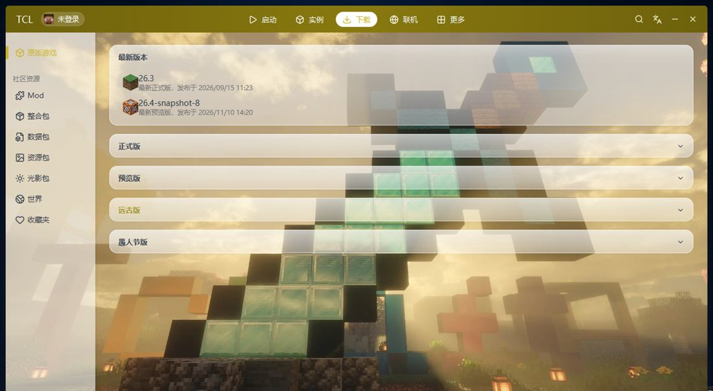

<div align="center">


# TCraft Launcher

**全新重写，轻装上阵。**

开源的 Minecraft Java 版启动器。绿色单文件，无捆绑、不上报数据；支持微软登录、EasyTier 联机、整合包与 Mod 下载，兼容 Windows / macOS / Linux。

[](https://github.com/Damianjiang/TCraft-Launcher/releases)
[](https://github.com/Damianjiang/TCraft-Launcher/releases)
[](LICENSE)
[](https://github.com/Damianjiang/TCraft-Launcher/releases)
[](https://learn.microsoft.com/java/openjdk/download#openjdk-17)

[下载最新版](https://github.com/Damianjiang/TCraft-Launcher/releases/latest) · [官网](https://tcraft.pages.dev) · [反馈问题](https://github.com/Damianjiang/TCraft-Launcher/issues) · [QQ 群](https://qm.qq.com/q/UONlv4VgwE)（1131373915）


</div>

## 界面

<table>
  <tr>
    <td width="50%"></td>
    <td width="50%"></td>
  </tr>
  <tr>
    <td width="50%"></td>
    <td width="50%"></td>
  </tr>
</table>

> 更多截图见[官网](https://tcraft.pages.dev)和[插件开发文档站](https://damianjiang.github.io/TCraft-Launcher/wiki/)。

## 功能

| 模块 | 能力 |
| --- | --- |
| 启动 | 多文件夹实例、收藏、内存分配、自动进服 |
| 账户 | 微软 / 离线 / 外置 Authlib |
| 实例 | 版本隔离；Mod、存档、资源包、光影、服务器管理 |
| 下载 | 原版与 Forge / NeoForge / Fabric / OptiFine；Mod、整合包、资源包、光影、世界 |
| Java / 联机 | Java 8/17/21/25；EasyTier 用户态组网 |
| 个性 / 其他 | 壁纸、主题、字体、音乐、皮肤；搜索、限速、三语、更新、错误导出 |
| 插件 | 页面、按钮、命令、弹窗、存储、事件、JavaFX 布局 |

## 插件

从 1.3.49 起支持第三方插件，入口为 `更多 → 插件`。1.3.50 起支持 `icon` / `thumbnail` 与统一分页。

- [插件开发文档站](https://damianjiang.github.io/TCraft-Launcher/wiki/)
- [文档源码](plugin-docs)
- [Hello 示例](https://damianjiang.github.io/TCraft-Launcher/wiki/examples/hello-plugin.zip)

插件与启动器同进程，拥有完整权限；只安装可信来源的插件。

## 下载

到 [Releases](https://github.com/Damianjiang/TCraft-Launcher/releases/latest) 下载，每个文件附 `.sha256`：

| 平台 | 文件 | 运行 |
| --- | --- | --- |
| Windows | `TCraftLauncher-<版本>-win.exe` | 双击 |
| macOS | `TCraftLauncher-<版本>.jar` | `java -jar` |
| Linux | `TCraftLauncher-<版本>-linux.sh` | `chmod +x` 后执行 |

需要 Java 17+；首次启动按平台下载 JavaFX 与 WebP 解码库到 `.tcl`。配置、日志和数据都在 `.tcl` 内，不写注册表、不装服务。

## 编译

需要 JDK 17+，`lib/` 提供 JavaFX 编译 jar：

```bash
javac --release 17 --module-path lib --add-modules javafx.controls,javafx.media \
      -cp 'lib/*:tools/webp-0.2.0.jar' \
      -encoding UTF-8 -d out src/tcraft/*.java src/tcraft/api/*.java
```

> `--release 17` 必须保留；Windows 下 `-cp` 分隔符改用 `;`。

打包：class 与 `res/` 打成一个 jar（`Main-Class: tcraft.Boot`）。Windows 单文件 exe：编译 `tools/launcher.c` → `python tools/add-icon.py` 注入图标 → 追加 jar。

## 项目结构

```
├── src/tcraft/     启动器源码（JavaFX）
├── res/            图标、语言表、样式、壁纸
├── lib/            JavaFX 编译依赖
├── tools/          Windows 单文件外壳与 WebP 解码库
├── plugin-docs/    插件文档源码（VitePress + Teek）
└── website/        官网与插件开发文档站
    ├── wiki/       构建后的文档
    └── ...         页面、样式、下载脚本、静态资源
```

## 致谢

- 交互参考 HMCL；代码独立编写，与 HMCL、PCL 无关联
- 图标来自 Lucide（ISC）；联机来自 EasyTier；WebP 解码使用 jwebp（Apache-2.0）
- Minecraft 是 Mojang / Microsoft 的商标，本启动器与其无关

## 许可

[MIT License](LICENSE)。
