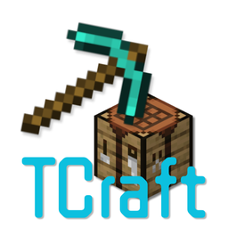
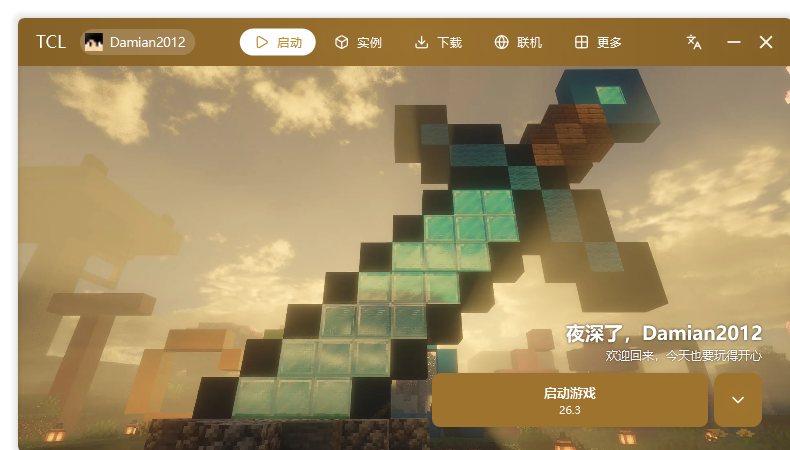
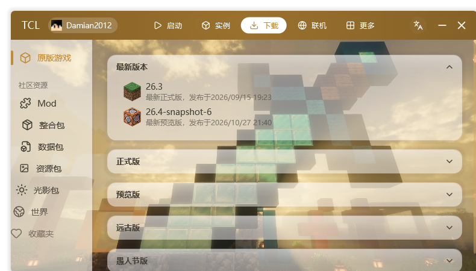
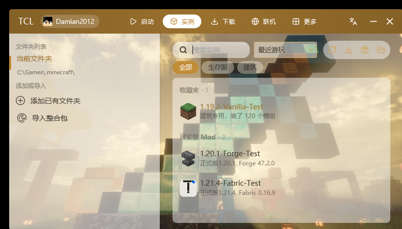
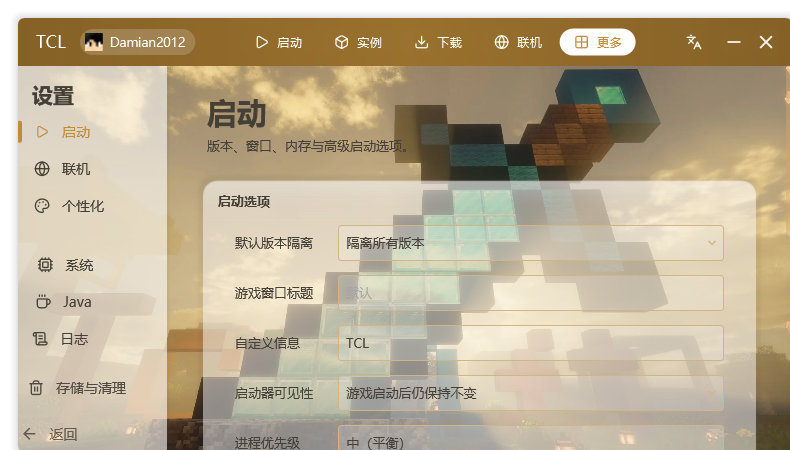

<div align="center">



# TCraft Launcher

**轻一点，快一点。**

一个单文件的 Minecraft 启动器：3.5 MB，冷启动约 2 秒，开源、免费、无广告。

[](https://github.com/Damianjiang/TCraft-Launcher/releases)
[](https://github.com/Damianjiang/TCraft-Launcher/releases)
[](LICENSE)
[](https://github.com/Damianjiang/TCraft-Launcher/releases)

[下载最新版](https://github.com/Damianjiang/TCraft-Launcher/releases) · [官网](https://damianjiang.github.io/TCraft-Launcher/) · [更新日志](CHANGELOG.md) · [English](README.en.md) · [反馈问题](https://github.com/Damianjiang/TCraft-Launcher/issues) · [TCraft Launcher 启动器交流群](https://qm.qq.com/q/WaG64YE9uo)（群号 1131373915）



</div>

---

## 这是什么

TCraft Launcher（简称 **TCL**）是一个用 VB.NET / WPF 写的 Minecraft 启动器。
它没有安装向导、没有捆绑、也没有任何统计上报：整个程序就是一个 3.5 MB 的 exe，
拷到哪儿都能跑，删掉就是卸载。

- **单文件发布**：启动核心与工具库以压缩快照内嵌进 exe，无需运行库依赖。
- **快**：延迟初始化 + 汇编缓存 + UI 资源按需加载，冷启动约 2 秒，空闲占用接近 0。
- **好看、可换**：Win11 风格半透明界面，支持自定义壁纸、背景视频、音乐与主题色。
- **多语言**：内置中英文，运行时可热更新语言表。

## 核心功能

| 模块 | 能力 |
| --- | --- |
| 启动 | 多版本选择、JVM / 游戏参数、内存分配、进程优先级、窗口模式、启动前命令 |
| 账户 | 微软设备码正版登录 / 离线登录 / 外置 Authlib 登录，账户卡片切换与导入导出 |
| 实例 | 多实例隔离、版本独立设置、Mod / 存档 / 数据包 / 截图 / 服务器管理、整合包导出 |
| 整合包 | CurseForge、Modrinth、MCBBS、MultiMC、HMCL 五种格式解析，安装前预览图标与版本 |
| 下载 | 原版与 Forge / NeoForge / Fabric / OptiFine / LiteLoader，CurseForge / Modrinth 资源搜索、断点续传 |
| 联机 | 基于 EasyTier 的虚拟局域网，创建 / 加入房间，直接联机单人存档 |
| 皮肤 | 2D 正视图 + WPF 3D 模型预览，自动识别经典 / 纤细模型 |
| 其他 | 崩溃分析（中文人话）、分类缓存清理、完整日志 |

## 界面

所有截图都来自真实运行，没有渲染图。

| 启动台 | 下载 |
| --- | --- |
|  |  |
|  |  |

## 下载

前往 [最新 Release](https://github.com/Damianjiang/TCraft-Launcher/releases) 下载 `TCraft-Launcher.exe`，双击运行即可。
该链接始终指向最新版本，页面无需随版本更新。

- **系统**：Windows 7 SP1 及以上（推荐 Windows 10 / 11），64 位
- **体积**：约 3.5 MiB（单文件，< 4 MB）
- **校验值**：见最新 Release 页面（随发布同步更新）
- **更新日志**：[CHANGELOG.md](CHANGELOG.md)，中英双语，按版本记录每次改动

> 项目未购买代码签名证书，SmartScreen 可能提示「未知发布者」。
> 可在 Release 页面核对校验值，或直接从源码构建。

> 微软正版登录在开源版中**默认未启用**：程序不内置任何微软凭据。
> 如需使用，注册一个 Azure 应用后设置环境变量 `TCL_MS_CLIENT_ID` 为你的 ClientId，重启启动器即可；
> 也可以加入 [TCraft Launcher 启动器交流群](https://qm.qq.com/q/WaG64YE9uo)（群号 **1131373915**）获取内置正版登录的完整版。

## 从源码构建

环境要求：

- Windows 10 及以上
- [Visual Studio 2022 Build Tools](https://visualstudio.microsoft.com/zh-hans/downloads/)，勾选 **.NET 桌面开发**（需要包含 Visual Basic 与 .NET Framework 4.8 目标包）
- 可选：[7-Zip](https://www.7-zip.org/)（用于压缩内嵌快照，体积更小）

```powershell
git clone https://github.com/Damianjiang/TCraft-Launcher.git
cd TCraft-Launcher
powershell -ExecutionPolicy Bypass -File scripts\build.ps1
```

构建产物在 `TCl\bin\TCraft Launcher.exe`。也可以直接用 Visual Studio 打开 `TCl.sln` 编译。

## 项目结构

```
├── TCl/          主程序（VB.NET + WPF）：界面、页面、业务逻辑
│   ├── Pages/        各功能页面
│   ├── Controls/     自研控件（列表项、卡片、消息框、滚动条等）
│   ├── Modules/      启动、下载、整合包、联机、皮肤等业务模块
│   └── Resources/    内嵌资源（第三方 DLL 压缩快照、字体、贴图）
├── TClCS/        启动核心（C#）：Java 管理、游戏启动、Minecraft 数据
├── TClKit/       共享工具库（JSON 解析、基础类型、WPF 辅助）
├── docs/         官网（GitHub Pages）
└── scripts/      构建脚本
```

## 参考与致谢

TCL 站在前人的肩膀上，这里把每一个来源都写清楚：

| 来源 | 参考内容 | 当前状态 |
| --- | --- | --- |
| [HMCL](https://github.com/HMCL-dev/HMCL)（GPL-3.0） | 功能规划与交互设计：账户管理布局、版本列表与详情页结构、皮肤编辑器的交互方式、3D 预览的思路 | 仅参考交互与功能形态，**未复制任何源代码**，全部用 VB.NET / WPF 重新实现 |
| [PCL](https://github.com/Meloong-Git/PCL)（Plain Craft Launcher） | 项目早期（1.0 之前）的版本安装、资源下载、启动参数构建等核心流程，参考了它的公开源码与实现思路 | 此后经过长期重构：模块重新划分、算法与数据结构重写、界面完全自绘，**当前代码与 PCL 的源文件已无直接对应关系**，TCL 是一个独立演化的项目 |
| [EasyTier](https://github.com/EasyTier/EasyTier) | 联机功能直接调用其官方发行版 | 以独立进程方式使用，未链接、未修改其源码 |
| [Lucide](https://lucide.dev/) | 界面图标 | 静态资源，遵循 ISC |

关于 PCL 的[分发许可](https://github.com/Meloong-Git/PCL/blob/main/LICENCE)：TCL 属于「参考实现思路后自行开发、且未与 PCL 混淆」的情形，因此按其中的「轻度使用」条款处理——给出署名、不暗示与 PCL 有关，也不使用 PCL 相关名称。如果权利人认为需要调整，请提 Issue，我们会第一时间配合。

同时感谢 Newtonsoft.Json、NAudio、Ookii.Dialogs 等开源组件，
完整清单见 [THIRD-PARTY-NOTICES.md](THIRD-PARTY-NOTICES.md)。

## 社区

- **TCraft Launcher 启动器交流群**：[点击加入](https://qm.qq.com/q/WaG64YE9uo)（群号 1131373915，更新通知、问题反馈、交流，本项目唯一即时通讯渠道）
- **Issue**：[提交问题反馈](https://github.com/Damianjiang/TCraft-Launcher/issues)
- **讨论区**：[GitHub Discussions](https://github.com/Damianjiang/TCraft-Launcher/discussions)

## 许可证

[MIT](LICENSE) © 2026 TCraft Team

## 免责声明

**NOT AN OFFICIAL MINECRAFT PRODUCT. NOT APPROVED BY OR ASSOCIATED WITH MOJANG OR MICROSOFT.**

非 Minecraft 官方产品。未经 Mojang 或 Microsoft 批准，也不与 Mojang 或 Microsoft 关联。
本启动器不包含、不分发 Minecraft 游戏本体；使用本软件即表示你已通过官方渠道购买了
Minecraft: Java Edition。侵权投诉与合规问题可通过 [Issue](https://github.com/Damianjiang/TCraft-Launcher/issues) 联系。

---

<div align="center">如果这个项目帮到了你，点一个 Star 就是最好的支持 ⭐</div>
