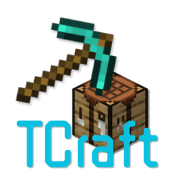
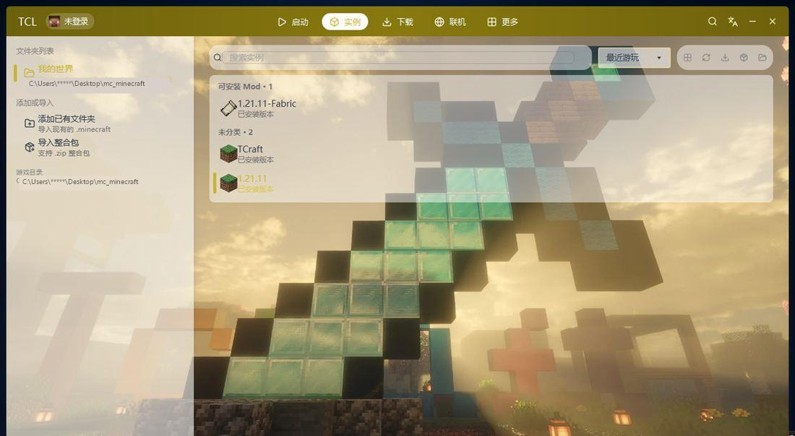
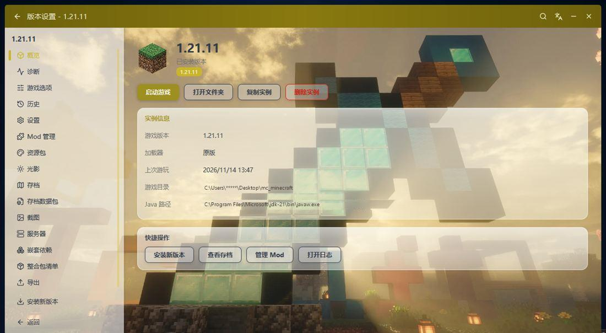
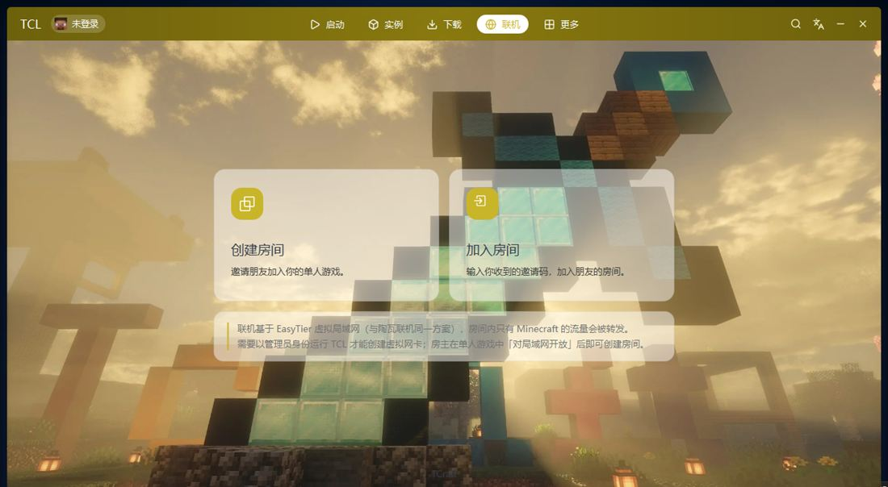

<div align="center">



# TCraft Launcher

**全新重写，轻装上阵。**

开源的 Minecraft Java 版启动器。支持微软正版登录、EasyTier 联机、
整合包与 Mod 下载，Windows / macOS / Linux 都可用。

[](https://github.com/Damianjiang/TCraft-Launcher/releases)
[](https://github.com/Damianjiang/TCraft-Launcher/releases)
[](LICENSE)
[](https://github.com/Damianjiang/TCraft-Launcher/releases)
[](https://learn.microsoft.com/java/openjdk/download#openjdk-17)

[下载最新版](https://github.com/Damianjiang/TCraft-Launcher/releases/latest) · [官网](https://damianjiang.github.io/TCraft-Launcher/) · [反馈问题](https://github.com/Damianjiang/TCraft-Launcher/issues) · [TCraft Launcher 启动器交流群](https://qm.qq.com/q/UONlv4VgwE)（群号 1131373915）


</div>

---

> [!NOTE]
> 遇到问题或有建议，欢迎到 [Issues](https://github.com/Damianjiang/TCraft-Launcher/issues) 反馈，
> 或[加入 QQ 交流群](https://qm.qq.com/q/UONlv4VgwE)（群号也写在启动器「更多 → 关于」里）。

## 这是什么

TCraft Launcher（简称 **TCL**）是用 JavaFX 写的 Minecraft 启动器。绿色单文件，
没有安装向导、没有捆绑、不上报数据，拷到哪里都能跑，删掉目录就算卸载。

- **单文件**：资源打进 jar，JavaFX 首次启动按当前系统下载到 `.tcl/dependencies`，三个平台共用同一个 jar
- **不碰系统**：配置只在 `.tcl/config.properties`，不写注册表、不装服务、不开机自启
- **界面**：半透明卡片压在背景图上，壁纸可以用图片或视频，主题色从背景里取；字体、标题栏、页面开关都能改
- **多平台**：Windows、macOS（Intel / Apple Silicon）、Linux（x64 / ARM）
- **多语言**：简体中文 / English / 繁體中文，切换即时生效

## 界面展示

<table>
  <tr>
    <td width="50%"></td>
    <td width="50%"></td>
  </tr>
  <tr>
    <td><sub>实例管理：多文件夹、版本分组、搜索与筛选</sub></td>
    <td><sub>游戏下载：正式版 / 预览版 / 远古版，Mod 与整合包都能下载</sub></td>
  </tr>
  <tr>
    <td width="50%"></td>
    <td width="50%"></td>
  </tr>
  <tr>
    <td><sub>版本设置：实例信息、内存分配、Java 运行时、渲染器</sub></td>
    <td><sub>联机房间：基于 EasyTier 用户态组网，凭 Base64 联机码直连</sub></td>
  </tr>
</table>

> 更多截图见[官网](https://damianjiang.github.io/TCraft-Launcher/)。

## 功能总览

| 模块 | 能力 |
| --- | --- |
| 启动 | 多文件夹多实例、收藏夹、内存分配可视化、进程优先级、启动加载窗、自动进入服务器 |
| 账户 | 微软正版登录（设备码，授权后自动完成）/ 离线登录 / 外置 Authlib 登录（LittleSkin 等）；实例可要求必须正版或禁止离线 |
| 实例 | 版本隔离（默认开启，每个版本独立 mods / 存档 / 配置，库与资源共用）、版本独立设置、Mod / 存档 / 数据包 / 资源包 / 光影 / 截图 / 服务器管理、实例复制与导出 |
| 整合包 | CurseForge、Modrinth、MultiMC、HMCL、MCBBS 导入；也可以把 `.zip` / `.mrpack` 或游戏目录直接拖进窗口 |
| 下载 | 原版与 Forge / NeoForge / Fabric / OptiFine 安装；Mod / 整合包 / 数据包 / 资源包 / 光影 / 世界下载；多镜像测速自动择优，可指定默认来源 |
| 运行环境 | 按需下载 Java 8 / 17 / 21 / 25，也可以扫描本机已有 Java 并排序；实例可按版本要求自动挑 Java；渲染器可选 DirectX 12（d3d12）或 Vulkan（zink） |
| 排错 | 游戏异常退出后自动分析崩溃原因（Mod 重复、版本不匹配、主类缺失、NBT、图形环境等），诊断页可直接看崩溃报告与启动参数 |
| 联机 | 基于 EasyTier `--no-tun` 用户态组网：创建 / 加入房间，房主「对局域网开放」后朋友凭 Base64 联机码直连，不需要管理员权限 |
| 皮肤 | 2D 正视图 + 3D 模型预览 |
| 个性 | 壁纸（图片 / 视频）、主题色与标题栏色相、标题栏 Logo 与文字、界面字体、背景音乐、导航页与设置分类开关 |
| 其他 | 全局搜索（Ctrl+K）、任务管理与限速、多语言切换、日志落盘、检查更新（正式版 / 测试版）、错误报告导出（报错、堆栈、诊断与最近日志） |

## 下载

到 [Releases](https://github.com/Damianjiang/TCraft-Launcher/releases/latest) 下载，每个文件都附 `.sha256`：

| 平台 | 文件 | 说明 |
| --- | --- | --- |
| Windows | `TCraftLauncher-<版本>-win.exe` | 双击运行，jar 已追加在 exe 末尾 |
| macOS | `TCraftLauncher-<版本>.jar` | 用 `java -jar` 运行，和 Windows / Linux 是同一个 jar |
| Linux | `TCraftLauncher-<版本>-linux.sh` | `chmod +x` 后直接执行，内含同一个 jar |

- 需要系统里有 **Java 17 或更高版本**（不捆绑 JRE）；没有的话启动器会引导下载
- 首次启动弹出 Java 选择窗口，可自动扫描或手动指定；确认后记在 `.tcl/launcher.cfg`，路径失效或版本读不出时再次提示
- 首次启动还会按当前系统下载 **JavaFX 17.0.21** 到 **`.tcl/dependencies/<平台>/openjfx`**（约 10 MB，之后复用）
- 内置 jar 解到 **exe 同目录的 `.tcl`**（同 HMCL 的 `./.hmcl`），不会被清理工具当临时文件删；目录写不出来时弹窗提示换位置，不改写到 `%LOCALAPPDATA%`
- 配置、日志、皮肤与实例图标都在 `.tcl` 内
- 联机首次使用会按平台下载 EasyTier 到 `.tcl/EasyTier` 并校验 SHA-256，使用 `--no-tun` 用户态组网，不需要管理员权限

## 编译与运行

需要 **JDK 17 或更高版本**。`lib/` 里是 JavaFX 17.0.21 的编译用 jar（base / graphics / controls / media，运行期也只下载这四个模块）：

```bash
javac --release 17 --module-path lib --add-modules javafx.controls,javafx.media \
      -encoding UTF-8 -d out src/tcraft/*.java
```

> `--release 17` 不能省：缺了它，用 JDK 21/25 编出的 class 是 21/25 字节码，
> JDK 17 加载会抛 `UnsupportedClassVersionError`。产物应为 major 61。

打包：class 与 `res/` 打成一个 jar（`Main-Class: tcraft.Boot`），`lib/` 只用于编译，
首次启动会按平台把 JavaFX 17.0.21 下载到 `.tcl/dependencies`，所以发布包不需要携带 JavaFX。

Windows 单文件包：编译 `tools/launcher.c` → `python tools/add-icon.py` 注入图标
（TCC 不能链接 `.rc`，直接写 PE 的 `.rsrc` 节）→ 追加 jar。

## 仓库结构

```
├── src/tcraft/     启动器源码（JavaFX）
├── res/            资源：图标、语言表、样式、内置壁纸
├── lib/            JavaFX 编译依赖（jar）
├── tools/          原生启动器源码（launcher.c）与图标注入脚本
└── website/        官网（GitHub Pages 自动部署）
```

`website/` 有改动并推送到 main 后，由 GitHub Actions 自动发布到 [GitHub Pages](https://damianjiang.github.io/TCraft-Launcher/)。

## 致谢与声明

- 本项目的功能规划与交互设计参考了 [HMCL](https://github.com/HMCL-dev/HMCL)（Hello Minecraft! Launcher）的成熟方案，界面与代码为独立编写，与 HMCL、PCL（Plain Craft Launcher）均无隶属、赞助或背书关系
- 界面图标来自 [Lucide](https://lucide.dev)（ISC），联机能力来自 [EasyTier](https://github.com/EasyTier/EasyTier)
- Minecraft 是 Mojang Synergies AB / Microsoft 的商标，本启动器与 Mojang、Microsoft 无关

## 许可

本项目基于 [MIT License](LICENSE) 开源，欢迎提 Issue 和 Pull Request。
