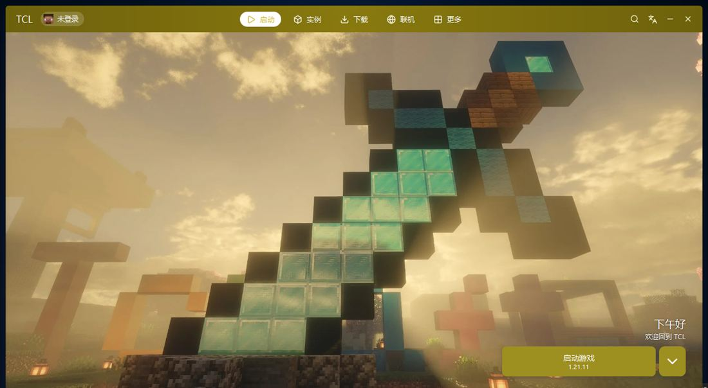

<div align="center">


# TCraft Launcher

**全新重写，轻装上阵。**

开源的 Minecraft Java 版启动器。绿色单文件，无安装向导、无捆绑、不上报数据；
支持微软正版登录、EasyTier 联机、整合包与 Mod 下载，Windows / macOS / Linux 都可用。

[](https://github.com/Damianjiang/TCraft-Launcher/releases)
[](https://github.com/Damianjiang/TCraft-Launcher/releases)
[](LICENSE)
[](https://github.com/Damianjiang/TCraft-Launcher/releases)
[](https://learn.microsoft.com/java/openjdk/download#openjdk-17)

[下载最新版](https://github.com/Damianjiang/TCraft-Launcher/releases/latest) · [官网](https://damianjiang.github.io/TCraft-Launcher/) · [反馈问题](https://github.com/Damianjiang/TCraft-Launcher/issues) · [QQ 交流群](https://qm.qq.com/q/UONlv4VgwE)（群号 1131373915）



</div>

## 界面展示

<table>
  <tr>
    <td width="50%"></td>
    <td width="50%"></td>
  </tr>
  <tr>
    <td width="50%"></td>
    <td width="50%"></td>
  </tr>
</table>

> 更多截图见[官网](https://damianjiang.github.io/TCraft-Launcher/)。

## 功能总览

| 模块 | 能力 |
| --- | --- |
| 启动 | 多文件夹多实例、收藏夹、内存分配、进程优先级、自动进入服务器 |
| 账户 | 微软正版 / 离线 / 外置 Authlib（LittleSkin 等）登录 |
| 实例 | 版本隔离、独立设置、Mod / 存档 / 资源包 / 光影 / 服务器管理、复制与导出 |
| 下载 | 原版与 Forge / NeoForge / Fabric / OptiFine；Mod、整合包、资源包、光影、世界；镜像测速择优 |
| 整合包 | CurseForge、Modrinth、MultiMC、HMCL、MCBBS 导入，支持拖入 `.zip` / `.mrpack` |
| Java | 按需下载 Java 8 / 17 / 21 / 25，或扫描本机 Java 自动挑选；渲染器可选 d3d12 / zink |
| 联机 | EasyTier `--no-tun` 用户态组网，联机码直连，无需管理员权限 |
| 排错 | 崩溃自动分析，诊断页可看崩溃报告与启动参数 |
| 个性 | 图片 / 视频壁纸、主题色、标题栏、字体、背景音乐、皮肤 2D / 3D 预览、页面开关 |
| 其他 | 全局搜索（Ctrl+K）、任务限速、简中 / 英 / 繁多语言、检查更新、错误报告导出 |

## 下载

到 [Releases](https://github.com/Damianjiang/TCraft-Launcher/releases/latest) 下载，每个文件都附 `.sha256`：

| 平台 | 文件 | 说明 |
| --- | --- | --- |
| Windows | `TCraftLauncher-<版本>-win.exe` | 双击运行 |
| macOS | `TCraftLauncher-<版本>.jar` | `java -jar` 运行 |
| Linux | `TCraftLauncher-<版本>-linux.sh` | `chmod +x` 后执行 |

- 需要 **Java 17+**（不捆绑 JRE，缺了会引导下载）；首次启动按平台下载 JavaFX 与 WebP 解码库到 `.tcl`
- 配置、日志与所有数据都在 exe 同目录 `.tcl` 内，不写注册表、不装服务，删掉目录即卸载

## 编译

需要 JDK 17+，`lib/` 提供 JavaFX 编译用 jar：

```bash
javac --release 17 --module-path lib --add-modules javafx.controls,javafx.media \
      -cp 'lib/*:tools/webp-0.2.0.jar' \
      -encoding UTF-8 -d out src/tcraft/*.java
```

> `--release 17` 不能省，否则 JDK 21/25 会编出高版本字节码，Java 17 加载报 `UnsupportedClassVersionError`；Windows 下 `-cp` 分隔符改用 `;`。

打包：class 与 `res/` 打成一个 jar（`Main-Class: tcraft.Boot`），依赖首次启动按平台下载，发布包无需携带。
Windows 单文件 exe：编译 `tools/launcher.c` → `python tools/add-icon.py` 注入图标 → 追加 jar。

## 仓库结构

```
├── src/tcraft/     启动器源码（JavaFX）
├── res/            图标、语言表、样式、内置壁纸
├── lib/            JavaFX 编译依赖
├── tools/          Windows 单文件外壳（launcher.c）与 WebP 解码库
└── website/        官网（推送 main 后自动发布到 GitHub Pages）
```

## 致谢与声明

- 功能规划与交互设计参考了 [HMCL](https://github.com/HMCL-dev/HMCL)，界面与代码独立编写，与 HMCL、PCL 均无隶属、赞助或背书关系
- 图标来自 [Lucide](https://lucide.dev)（ISC），联机能力来自 [EasyTier](https://github.com/EasyTier/EasyTier)，WebP 解码使用 [jwebp](https://github.com/Glavo/jwebp)（Apache-2.0）
- Minecraft 是 Mojang / Microsoft 的商标，本启动器与其无关

## 许可

[MIT License](LICENSE)，欢迎提 Issue 和 Pull Request。
