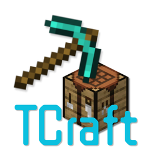
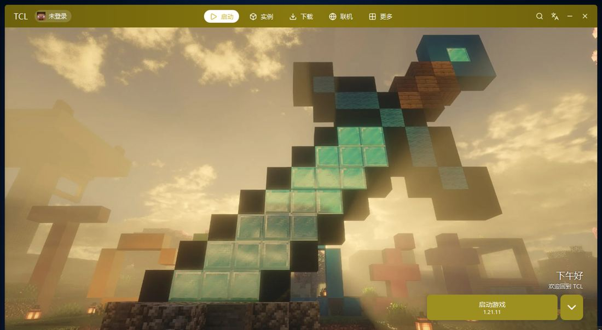
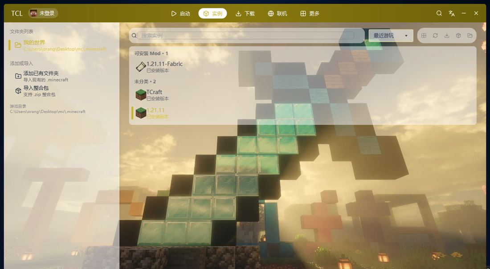
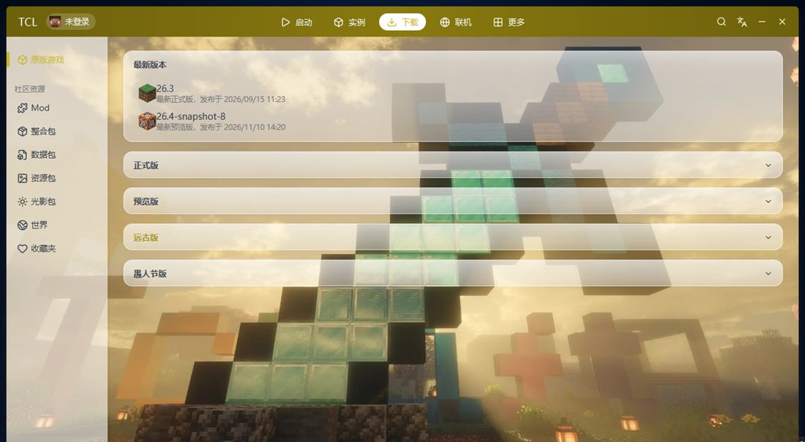
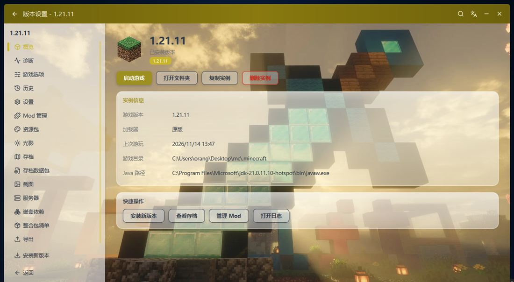
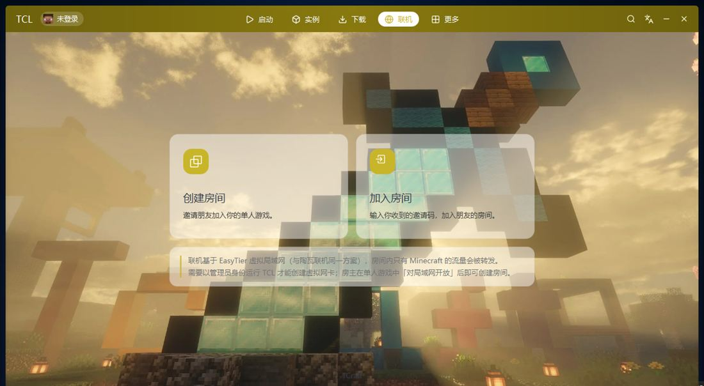

<div align="center">



# TCraft Launcher

**全新重写，轻装上阵。**

一个免费开源的 Minecraft Java 版启动器：毛玻璃界面、主题色跟随壁纸、
正版登录、联机房间、整合包下载，Windows / macOS / Linux 全平台可用。

[](https://github.com/Damianjiang/TCraft-Launcher/releases)
[](https://github.com/Damianjiang/TCraft-Launcher/releases)
[](LICENSE)
[](https://github.com/Damianjiang/TCraft-Launcher/releases)
[](https://learn.microsoft.com/java/openjdk/download#openjdk-17)

[下载最新版](https://github.com/Damianjiang/TCraft-Launcher/releases/latest) · [官网](https://damianjiang.github.io/TCraft-Launcher/) · [反馈问题](https://github.com/Damianjiang/TCraft-Launcher/issues) · [TCraft Launcher 启动器交流群](https://qm.qq.com/q/UONlv4VgwE)（群号 1131373915）



</div>

---

> [!NOTE]
> **v1.0.0 是 JavaFX 独立重构后的第一个正式版。** 相比旧版（VB.NET / WPF）这是一次彻底重写，架构和界面都是全新的，但也意味着很多地方还不够成熟：部分功能仍在打磨、个别设置项可能不生效、macOS 与 Linux 也没有经过充分测试。
> 遇到问题、有想法，或者只是想围观开发进度，都欢迎到 [Issues](https://github.com/Damianjiang/TCraft-Launcher/issues) 提交反馈，或者[加入 QQ 交流群](https://qm.qq.com/q/UONlv4VgwE)（群链接也写在启动器「更多 → 关于」里）。

## 这是什么

TCraft Launcher（简称 **TCL**）是一个用 JavaFX 写的 Minecraft 启动器，从界面到核心全部重写：
单文件发布、无安装向导、无捆绑、无统计上报，拷到哪儿都能跑，删掉就是卸载。

- **单文件发布**：资源与 JavaFX 运行库内嵌进 exe，首次运行自动解压到用户目录，无需额外安装。
- **好看、可换**：毛玻璃卡片压在背景图上，主题色从壁纸自动提取，另有 30 种预设色板；组件透明度、动画速度都能调。
- **多平台**：Windows、macOS（Intel / Apple Silicon）、Linux（x64 / ARM）。
- **多语言**：简体中文 / English / 繁體中文，切换即时生效。

## 界面展示

<table>
  <tr>
    <td width="50%"></td>
    <td width="50%"></td>
  </tr>
  <tr>
    <td><sub>实例管理：多文件夹、版本分组、搜索与筛选</sub></td>
    <td><sub>游戏下载：正式版 / 预览版 / 远古版，Mod 与整合包一站下载</sub></td>
  </tr>
  <tr>
    <td width="50%"></td>
    <td width="50%"></td>
  </tr>
  <tr>
    <td><sub>版本设置：实例信息、内存分配、Java 运行时</sub></td>
    <td><sub>联机房间：基于 EasyTier 虚拟局域网，邀请码即开即玩</sub></td>
  </tr>
</table>

> 更多截图见[官网](https://damianjiang.github.io/TCraft-Launcher/)。

## 功能总览

| 模块 | 能力 |
| --- | --- |
| 启动 | 多文件夹多实例、收藏夹、内存分配可视化、进程优先级、愚人节彩蛋 |
| 账户 | 微软正版登录（浏览器登录完自动跳回，无需手动复制链接）/ 离线登录 / 外置 Authlib 登录（LittleSkin 等） |
| 实例 | 版本独立设置、Mod / 存档 / 数据包 / 资源包 / 光影 / 截图 / 服务器管理、实例复制与导出 |
| 整合包 | CurseForge、Modrinth 整合包导入 |
| 下载 | 原版与 Forge / NeoForge / Fabric / OptiFine 安装；Mod / 整合包 / 数据包 / 资源包 / 光影 / 世界下载；多镜像测速自动择优 |
| 联机 | 基于 EasyTier 的虚拟局域网：创建 / 加入房间，房主「对局域网开放」后朋友凭邀请码直连 |
| 皮肤 | 2D 正视图 + 3D 模型预览 |
| 其他 | 全局搜索（Ctrl+K）、任务管理与限速、多语言切换、背景音乐、日志落盘 |

## 下载

到 [Releases](https://github.com/Damianjiang/TCraft-Launcher/releases/latest) 下载对应平台的单文件版，均附带 SHA256 校验：

| 平台 | 文件 | 说明 |
| --- | --- | --- |
| Windows | `TCraftLauncher-*-win.exe` | 双击运行 |
| macOS | `TCraftLauncher-*-mac*.jar` / `.command` | Intel 与 Apple Silicon 分包 |
| Linux | `TCraftLauncher-*-linux.sh` / `.deb` | x86_64 与 aarch64 |

- 启动器自带 JavaFX，不带 JRE，需要系统里有 **Java 17 或更高版本**；单文件版找不到 Java 时会弹出选择窗口：可自动扫描（带进度和逐条结果）、手动浏览指定 `java.exe`，也能直接跳转下载页。选中的路径记在 `.tcl\launcher.cfg`，之后启动直接复用，不再弹窗；一旦这个 Java 被删除或移动，会自动重新扫描，扫不到才会再次弹窗
- 单文件版会把内置 jar 解到 **exe 同目录的 `.tcl`**（跟 HMCL 的 `./.hmcl` 一个路子，不会被磁盘清理工具当临时文件清掉）；exe 在 `Program Files` 等只读位置时才回退到 `%LOCALAPPDATA%\.tcl`
- 配置、日志、资源与运行库也都放在 `.tcl` 里（首次会从旧的 `~/.tcraft-launcher-javafx` 迁移配置）；直接用 `java -jar` 运行时没有 `-Dtcraft.dir`，仍沿用旧目录
- 联机功能首次使用会按平台自动下载 EasyTier：Windows 需要管理员权限，macOS 按弹窗授权，Linux 建议 `sudo` 运行

## 编译与运行

需要 JDK 17 或更高版本，克隆后用仓库自带的 JavaFX 运行库直接编译：

```bash
javac --module-path lib --add-modules javafx.controls,javafx.graphics,javafx.base,javafx.media \
      -encoding UTF-8 -d out src/tcraft/*.java

java --module-path lib --add-modules javafx.controls,javafx.graphics,javafx.base,javafx.media \
     -cp out tcraft.Boot
```

打 Windows 单文件包时，先编译 `tools/launcher.c` 得到 stub，再用
`python tools/add-icon.py stub.exe stub-icon.exe res/images/icon.ico` 嵌图标
（TCC 不支持链接 `.rc`，这一步直接往 PE 里写 `.rsrc` 节），最后把 jar 追加到 exe 末尾。

## 仓库结构

```
├── src/tcraft/     启动器源码（JavaFX）
├── res/            资源：图标、语言表、样式、内置壁纸
├── lib/            各平台 JavaFX 运行库
├── tools/          原生启动器源码（launcher.c）
├── website/        官网（GitHub Pages 自动部署）
└── dist/           构建产物（不入库）
```

官网在推送后由 GitHub Actions 自动发布到 [GitHub Pages](https://damianjiang.github.io/TCraft-Launcher/)。

## 致谢与声明

- 本项目的功能规划与交互设计参考了 [HMCL](https://github.com/HMCL-dev/HMCL)（Hello Minecraft! Launcher）的成熟方案，界面与代码为独立编写，与 HMCL、PCL（Plain Craft Launcher）均无隶属、赞助或背书关系
- 界面图标来自 [Lucide](https://lucide.dev)（ISC），联机能力来自 [EasyTier](https://github.com/EasyTier/EasyTier)
- Minecraft 是 Mojang Synergies AB / Microsoft 的商标，本启动器与 Mojang、Microsoft 无关

## 许可

本项目基于 [MIT License](LICENSE) 开源。欢迎提 Issue 与 Pull Request，也欢迎 Star 支持。
